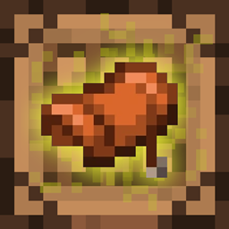
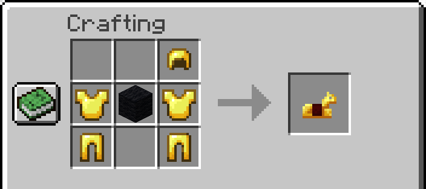
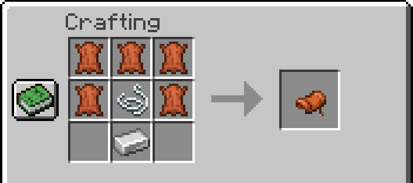

#  Craftable Horse Items

A Minecraft mod that adds crafting recipes for horse armor and an extra saddle recipe.
Available for **Fabric**, **Quilt** (uses the Fabric jar) and **NeoForge**.

## Recipes

**Horse armor** (copper, iron, golden, diamond): a helmet, two chestplates and two leggings of the
same material around a block of black wool.

**Saddle**: five leather, a string and an iron ingot (in addition to the vanilla recipe).

Leather horse armor is already craftable in vanilla, and netherite horse armor is made from diamond
horse armor at a smithing table. The recipes unlock in the recipe book as soon as you pick up one of
the ingredients.

The mod only adds data (recipes and recipe-book advancements), so it is needed on the server (or in
singleplayer). Clients joining a server do not need it. On Fabric and Quilt it requires
[Fabric API](https://modrinth.com/mod/fabric-api) (or QFAPI on Quilt).

## Building

`./gradlew build` produces `fabric/build/libs/*.jar` and `neoforge/build/libs/*.jar`.
The recipes live in `common/src/main/resources` and are packed into both jars.

## Branches

Each Minecraft version has its own branch, e.g. `26.3`. All version-specific values live in that
branch's `gradle.properties`.

## Publishing

The `publish` GitHub workflow builds the selected branch and uploads both jars to CurseForge and
Modrinth (Actions > publish > Run workflow, or publish a GitHub release). It needs the repository
secrets `CURSEFORGE_TOKEN` and `MODRINTH_TOKEN` and the `curseforge_id` / `modrinth_id` values in
`gradle.properties`. Locally, `./gradlew publishMods` does a dry run when the tokens are not set.
